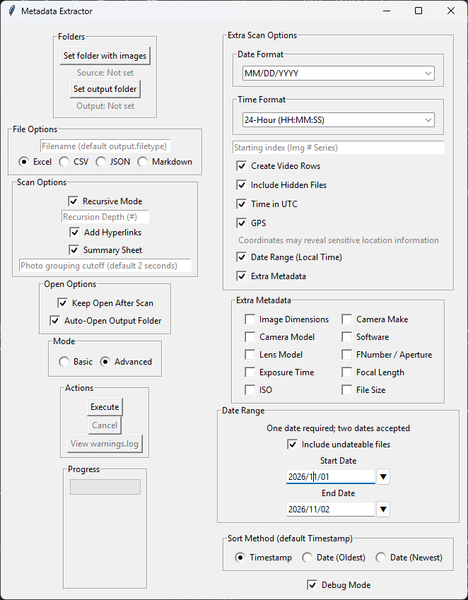

# Metadata Extractor by Pianocraft1YT

---
Metadata Extractor is a Tkinter desktop utility for cataloging folders of camera, drone, or action-cam media. It extracts EXIF metadata from photos and `mvhd` creation timestamps from `.mp4`/`.mov` videos, groups captures into bursts by timestamp proximity, and exports formatted Excel, CSV, JSON, or Markdown reports.

Folders of photos and videos are clustered chronologically using a configurable **Photo grouping cutoff** (default `2` seconds). By default, videos contribute timestamps and series slots without producing output rows; enabling **Create Video Rows** (Advanced mode) includes timestamped videos directly in the exported tables. Photos or videos without timestamps are handled cleanly without aborting the folder.

Executable found here: https://github.com/Pianocraft1YT/MetadataExtractor/releases

Release History/Roadmap found here: https://github.com/Pianocraft1YT/MetadataExtractor/blob/main/ReleaseNotes.md

## Features

- **EXIF & sub-IFD extraction**: Reads `DateTimeOriginal`, `DateTimeDigitized`, and `DateTime` (across IFD0 and the Exif sub-IFD) from JPEG, PNG, TIFF, and more, plus optional `.heic`/`.heif` support when `pillow-heif` is installed, as well as RAW extension support when `exifread` is installed.
- **Timestamp-proximity burst grouping**: Groups photos and `.mp4`/`.mov` videos captured within a configurable **Photo grouping cutoff** (default `2.0` seconds; `0` groups identical timestamps) and assigns shared `Img # Series` labels (e.g. `1-3`) with an optional custom starting index.
- **Basic and Advanced modes**: Launches in a streamlined **Basic** view for everyday scans and expands **Advanced** controls (Debug Mode, Create Video Rows, Starting index, Sort Method, Date Range, Hidden Files, Time in UTC, GPS, Extra Metadata) on demand.
- **Create Video Rows (Advanced)**: Opt-in toggle that emits output rows for timestamped `.mp4`/`.mov` videos (including video-only bursts and folders) with `File Size` and optional video `Dimensions` (when `hachoir` is installed).
- **Full recursive scanning**: Walk directory trees up to a configurable **Recursion Depth**. Each media-bearing subfolder becomes its own worksheet (Excel/JSON) or its own CSV/Markdown file.
- **Sorting & date filtering (Advanced)**: Sort rows by `Timestamp` (default), `Date (Oldest)`, or `Date (Newest)` (keeping bursts intact), and optionally filter media by Start/End local dates with an **Include undateable files** toggle.
- **Media Filtering (Advanced)**: Scan only selected media files, Photos Only, Videos, Only, Raw Only, and All Media.
- **Live progress bar & cancellation**: Threaded scanning with single-open photo/video caching, live scanned/skipped counters, current subfolder display, ETA, elapsed time, and a **Cancel** button.
- **Formatted output formats**: Excel (`.xlsx` with frozen header row, bold headers, AutoFilter, auto-fitted column widths, XML control-character scrubbing, and formula-injection neutralization), CSV (`.csv`), JSON (`.json`), and GitHub-Flavored Markdown (`.md`).
- **Optional UTC conversion (Advanced)**: Pairs each matched EXIF datetime with its corresponding `OffsetTime*` tag and shifts timestamps to UTC before burst clustering and formatting.
- **Optional extra metadata columns (Advanced)** via **Extra Metadata**: `Image Dimensions`, `File Size`, `Camera Make`, `Camera Model`, `Software`, `Lens Model`, `FNumber / Aperture`, `Exposure Time`, `Focal Length`, `Orientation` and `ISO` — each individually toggleable.
- **Optional GPS coordinates (Advanced)**: `GPS Latitude` and `GPS Longitude` from the GPS IFD as signed decimal degrees (6-decimal precision), with an on-screen privacy notice when enabled, along with a **GPS Altitude** option.
- **Clickable hyperlinks**: Links filenames in the `Files` column to the files on disk in Excel (`file:///` URIs) and Markdown (`[name](<url>)`). Unsupported in CSV and JSON.
- **Optional Summary Sheet**: Includes item totals, items dated/undated, series groups, earliest/latest dates, and total folder/workbook `File Size`, with clickable `Source Path` folder hyperlinks in Excel.
- **Clean UI**: Two-column UI with LabelFrames, checkbuttons, comboboxes, buttons, radiobuttons, entries, labels, and progressbar widgets.
- **Path visibility, auto-open, & `warnings.log` viewer**: Displays truncated `Source:` and `Output:` paths in the main window, optionally opens the output folder on completion (**Auto-Open Output Folder**), and provides a **View warnings.log** button whenever warnings are written.
- **Persistent settings & one-click reset**: Saves UI options and folder selections to `~/.metadata-extractor/settings.json` (Debug Mode is never persisted), with a **Reset Settings** button to clear saved preferences and restore factory defaults.
- **GUI & Headless CLI modes**: Launches the desktop Tkinter UI when run with no arguments, or runs completely headlessly via `argparse` flags for terminal and scripted workflows.

## Output formats

| Format | Extension | Per-subfolder files | Hyperlinks |
|---|---|---|---|
| Excel | `.xlsx` | No (one workbook, one sheet per folder) | Yes |
| CSV | `.csv` | Yes | No |
| JSON | `.json` | No (one file, one dict per sheet) | No |
| Markdown | `.md` | Yes | Yes |

CSV and Markdown can't nest multiple sheets inside a single file, so in recursive mode they produce one file per subfolder — and prompt for confirmation before running.

## Limitations

- **Video containers & timestamps**: `mvhd` timestamp extraction supports `.mp4` and `.mov` containers; `.mkv`, `.avi`, `.webm`, and `.wmv` cannot contribute timestamps (logged under `"Unsupported Video Format"`), and video timestamps are read as naive wall-clock time.
- **Dateless videos**: Even with **Create Video Rows** enabled, videos without a readable `mvhd` timestamp do not produce output rows.
- **Optional dependencies**: `.heic`/`.heif` decoding requires `pillow-heif` (without it, HEIC/HEIF files are skipped with `"HEIC/HEIF requires pillow-heif"` in `warnings.log`). Video dimensions in **Create Video Rows** require `hachoir`. RAW support requires `exifread` installation.
- **Hyperlinks**: Supported in Excel and Markdown only, not CSV or JSON.
- **Markdown scope**: Markdown output does not include frontmatter, per-column alignment, or hyperlinks outside the `Files` column.

## Requirements

- Python 3.11 or newer (3.11, 3.12, 3.13, and 3.14 supported and tested)
- Pillow
- pandas
- openpyxl
- tk-date-entry
- tkinter (usually included with Python)
- **Optional**: `pillow-heif` (for `.heic`/`.heif` support), `hachoir` (for video dimensions when **Create Video Rows** is enabled), `exifread` for RAW photo support.

## Basic usage

1. Run `metadata.exe` (or `python metadata.py`).
2. Click **Set folder with images** and choose the media folder, then click **Set output folder** and choose where exports should be saved.
3. Optionally adjust **Photo grouping cutoff (default 2 seconds)**, enter a custom filename, or check **Add Hyperlinks**, **Keep Open After Scan**, and **Auto-Open Output Folder**.
4. Check **Recursive Mode** if you want to scan subfolders, and enter a **Recursion Depth** (defaults to `1` if left unset).
5. Switch to **Advanced** if you want **Debug Mode**, **Create Video Rows**, custom **Starting index**, **Sort Method**, **Date Range (Local Time)**, **Include Hidden Files**, **Time in UTC**, **GPS**, **Date Format**, **Time Format** or **Extra Metadata** columns.
6. Choose **Excel**, **CSV**, **JSON**, or **Markdown** output format.
7. Click **Execute**. A live progress bar tracks the scan; if any warnings are logged, click **View warnings.log** afterward to inspect them.
---
## Command-Line Interface (CLI)

Passing any argument runs Metadata Extractor headlessly without opening a window or modifying your saved GUI `settings.json`:

```bash
python metadata.py -i ./Photos -o ./report.xlsx
```

### Common Examples

```bash
# Recursive Excel export with Summary Sheet and UTC conversion
python metadata.py -i ./Trips -o ./trips.xlsx -r -md 2 -s -u -y

# Export all EXIF metadata + GPS + Altitude to JSON quietly
python metadata.py -i ./Camera -o ./shoot.json -a -ga -q

# Filter by local date range, RAW only, sorted oldest-first, 12-hour time
python metadata.py -i ./RAW -o ./may.csv -M raw -sd 2024-05-01 -ed 2024-05-31 -S oldest -t 12h
```

### CLI Options

| Flag | Description |
|---|---|
| `-i`, `--input` | Source folder to scan *(required)* |
| `-o`, `--output` | Output file path *(required)* |
| `-f`, `--filetype` | `excel`, `csv`, `json`, or `markdown` (inferred from `--output` extension if omitted) |
| `-y`, `--overwrite` | Overwrite existing output files (without this, existing files fail with exit code `1`) |
| `-hl`, `--hyperlinks` / `--no-hyperlinks` | Toggle clickable file/folder links (defaults on for Excel/Markdown) |
| `-s`, `--summary` | Include Summary Sheet on multi-folder scans |
| `-q`, `--quiet` | Suppress non-error stdout messages |
| `-r`, `--recursive` | Scan subfolders (defaults to depth `1` unless `-md` is set) |
| `-md`, `--maxdepth` | Maximum recursion depth (`>= 1`) |
| `-c`, `--cutoff` | Burst grouping cutoff in seconds (default `2.0`) |
| `-m`, `--modifier` | Starting index offset for `Img # Series` (default `0`) |
| `-vr`, `--videorows` | Emit output rows for timestamped `.mp4`/`.mov` videos |
| `-H`, `--hidden` | Include hidden files and folders |
| `-u`, `--utc` | Convert timestamps to UTC using EXIF offsets |
| `-S`, `--sort` | `timestamp` (default), `oldest`, or `newest` |
| `-df`, `--date-format` | `MM/DD/YYYY` (default), `YYYY-MM-DD`, or `DD/MM/YYYY` |
| `-t`, `--time-format` | `24h` (default) or `12h` |
| `-sd`, `--start-date` / `-ed`, `--end-date` | Local date filter bounds (`YYYY-MM-DD`) |
| `-iu`, `--include-undateable` / `--no-include-undateable` | Include or exclude files without timestamps when filtering by date (default on) |
| `-M`, `--media` | `all` (default), `photos`, `videos`, or `raw` |
| `-g`, `--gps` / `-ga`, `--gps-altitude` | Export GPS Latitude/Longitude (and GPS Altitude; `-ga` enables `-g`) |
| `-a`, `--all` | Enable all extra EXIF columns (`-d`, `-fs`, `-mk`, `-mo`, `-sft`, `-l`, `-apt`, `-e`, `-fl`, `-iso`, `-or`) |
| `-d`, `-fs`, `-mk`, `-mo`, `-sft`, `-l`, `-apt`, `-e`, `-fl`, `-iso`, `-or` | Individual Extra EXIF flags (`--dimensions`, `--filesize`, `--make`, `--model`, `--software`, `--lens`, `--aperture`, `--exposure`, `--focal-length`, `--iso`, `--orientation`) |

**Exit codes:** `0` = files written successfully, `1` = validation/overwrite/empty-scan/I/O error, `2` = invalid CLI arguments.

---
## Building from Source

To compile the standalone Windows executable:

```
pyinstaller --onefile --windowed metadata.py
```
This program runs cross-platform on Windows, macOS, and Linux (though prebuilt binaries are currently published for Windows).

## Video Tutorial
A video tutorial is planned for December 2026, will add when finished